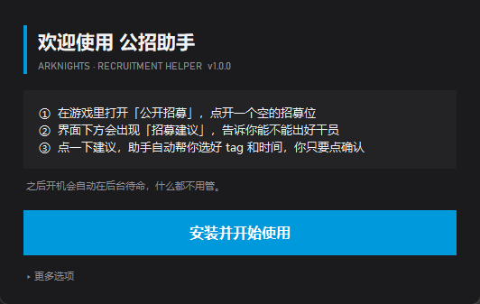

# 明日方舟 公招助手 / Arknights Recruit Helper

打开公开招募，助手直接在游戏画面里告诉你**这次能不能出好干员、该选哪几个 tag**，
点一下就帮你选好 tag 和时间。你只需要按确认。


---

## 怎么用（3 步）

1. 到 **[Releases](../../releases/latest)** 下载 **`ArknightsRecruitHelper.exe`**
2. 双击它，Windows 问「是否允许此应用更改设备」时点 **是**
3. 点蓝色大按钮 **「安装并开始使用」**



完成！以后开机它会自己在后台待命，**不用再打开任何东西**。
进游戏 → 公开招募 → 点一个空的招募位，下方就会出现「招募建议」。

### 如果出现「Windows 已保护你的电脑」
这是因为这个小工具没有花钱买微软签名，不是病毒。点 **「更多信息」→「仍要运行」** 即可。

### 招募建议怎么看
| 显示 | 意思 |
|---|---|
| **6★** 橙色 | 有「高级资深干员」，必出六星！ |
| **5★** 金色 | 选这几个 tag 必出五星 |
| **4★** 紫色 | 选这几个 tag 必出四星 |
| **1★ 小车** | 只选「支援机械」，时间 3:50，必出小车 |
| 只能三星 | 建议点游戏里的刷新 |

点建议上的按钮 → 助手自动勾选 tag、设好时间 → 你检查一下，点确认就行。
（助手**永远不会**替你点确认或刷新。）

### 常见问题
- **看不到招募建议？** 游戏要用窗口或无边框模式（不要独占全屏）。也可以按 **F8** 手动识别。
- **想暂时隐藏？** 按 **F9**。
- **设置 / 卸载？** 右下角任务栏托盘里的蓝色菱形图标 → 设置。卸载在设置最下方。
- **更新？** 下载新版 exe 双击即可，会自动替换旧版。干员数据会在每次游戏启动时自动更新。
- **国际服 / English？** 自动识别；界面语言跟随系统，也可在设置里改。

---

## For English players

1. Download **`ArknightsRecruitHelper.exe`** from **[Releases](../../releases/latest)**
2. Double-click it and allow the admin prompt
3. Press **Install & start**

It then starts with Windows automatically. Open Recruitment in the game, tap an empty slot,
and an **Advice** row appears under the dialog. Click a suggestion and the tags and timer are set for you;
you just press confirm. If Windows shows "Windows protected your PC", click **More info → Run anyway**.

---

## 开发者 / Developers

```
python app.py            # 从源码运行（首次会打开设置向导）
setup.bat                # 源码版安装依赖 + 向导
build.bat                # 打包成 dist\ArknightsRecruitHelper.exe（干净 venv，约 100MB）
python app.py --selftest # 自检：数据 + OCR
```

发布：推送 `v*` 标签（例如 `git tag v1.0.1 && git push origin v1.0.1`），GitHub Actions 会自动打包、自检并发布到 Releases。

| 文件 | 作用 |
|---|---|
| `app.py` | 主程序：监视循环、主窗口、设置、托盘、安装向导、自动选择 |
| `overlay.py` | 游戏风格界面：嵌入卡片、括号标记、侧边面板 |
| `ocr_engine.py` | OCR + 公招界面几何（tag 位置、选中状态、时间箭头） |
| `winutil.py` | 游戏窗口、截图、点击、计划任务、快捷方式、安装路径 |
| `recruit_core.py` | 干员数据下载/自动更新、tag 匹配、组合计算 |

运行方式：exe 版装在 `%LOCALAPPDATA%\Programs\ArknightsRecruitHelper`，设置和数据在 `%APPDATA%\ArknightsRecruitHelper`。
助手只在游戏是当前窗口、且画面变化后才做 OCR；数据来自 [ArknightsGameData](https://github.com/Kengxxiao/ArknightsGameData)。
