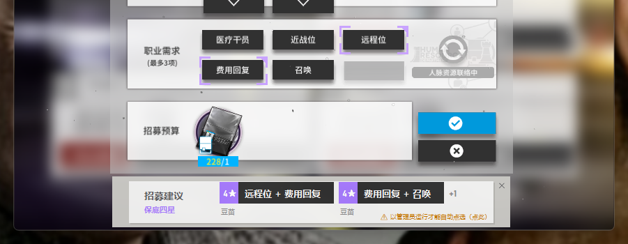

# 明日方舟 公招助手 / Arknights Recruit Helper

打开公开招募，助手直接在游戏画面里告诉你**这次能不能出好干员、该选哪几个 tag**，
点一下就帮你选好 tag 和时间。你只需要按确认。

支持 **国服 · 国际服 · 日服 · 韩服**（日服/韩服为 beta）· 界面：中文 / English / 日本語 / 한국어



---

## 怎么用（3 步）

1. 到 **[Releases](../../releases/latest)** 下载 **`ArknightsRecruitHelper.exe`**
2. 双击它，Windows 问「是否允许此应用更改设备」时点 **是**
3. 点蓝色大按钮 **「安装并开始使用」**


完成！以后开机它会自己在后台待命，**不用再打开任何东西**。
打开明日方舟（国服、国际服都行）→ 公开招募 → 点一个空的招募位，旁边就会出现「招募建议」。
关掉助手窗口只是让它休息，**下次打开游戏会自动回来**。

### 如果出现「Windows 已保护你的电脑」
这是因为这个小工具没有花钱买微软签名，不是病毒。点 **「更多信息」→「仍要运行」** 即可。

### 招募建议怎么看
| 显示 | 意思 |
|---|---|
| **6★** 橙色 | 有「高级资深干员」，必出六星！ |
| **5★** 金色 | 选这几个 tag 必出五星 |
| **4★** 紫色 | 选这几个 tag 必出四星 |
| **1★ 小车** | 只选「支援机械」，时间 3:50，必出小车 |
| 只能三星 | 建议点游戏里的刷新 |

点建议上的按钮 → 助手自动勾选 tag、设好时间 → 你检查一下，点确认就行。
（助手**永远不会**替你点确认或刷新。）

### 常见问题
- **看不到招募建议？** 游戏要用窗口或无边框模式（不要独占全屏）。也可以按 **F8** 手动识别。
- **想暂时隐藏？** 按 **F9**。
- **设置 / 卸载？** 右下角任务栏托盘里的蓝色菱形图标 → 设置。卸载在设置最下方。
- **想彻底关掉？** 托盘图标 →「完全退出」（下次开机才会再启动）。
- **更新？** 下载新版 exe 双击即可，会自动替换旧版。干员数据会在每次游戏启动时自动更新。
- **国际服 / 日服 / 韩服？** 自动识别；界面语言跟随系统，也可在设置里改。
  日服/韩服第一次使用时会自动下载对应的文字识别模型（约 10 / 13MB，只下载一次，有校验）。目前是 **beta**：
  如果某个 tag 没识别出来，可以在主窗口「手动选择 tag」里补上，也欢迎提 issue 附截图。

### 安全
助手需要管理员权限（因为游戏本身以管理员运行，要自动点选必须同级），所以做了这些保护：
- 程序装在 `C:\Program Files`，普通软件无法篡改它来“借”管理员权限
- 只会启动有**鹰角/悠星官方数字签名**的启动器
- 自动点选只点游戏窗口里的 tag 和时间箭头，**永远不点确认/刷新**；你一动鼠标或切走窗口就立刻停止
- 下载的干员数据会做格式和大小检查，异常数据不会被使用
- 不联网上传任何东西；只从 GitHub 下载公开的游戏数据

---

## 日本のプレイヤーへ（β）

1. **[Releases](../../releases/latest)** から **`ArknightsRecruitHelper.exe`** をダウンロード
2. ダブルクリックして管理者権限を許可
3. **「インストールしてはじめる」** を押す

あとはゲームで公開求人を開き、空いている募集枠をタップするだけ。画面の横に「おすすめ」が表示され、
クリックするとタグと時間を自動で設定します（確定はご自身で）。初回のみ日本語の文字認識モデル（約 10MB）を自動ダウンロードします。

## 한국 플레이어 (베타)

1. **[Releases](../../releases/latest)** 에서 **`ArknightsRecruitHelper.exe`** 다운로드
2. 더블클릭 후 관리자 권한 허용
3. **「설치하고 시작하기」** 클릭

게임에서 공개모집을 열고 빈 모집 칸을 누르면 화면 옆에 「추천」이 나타납니다. 클릭하면 태그와 시간이 자동으로
설정됩니다 (확인은 직접). 처음 한 번만 한국어 문자 인식 모델(약 13MB)을 자동으로 내려받습니다.

---

## For English players

1. Download **`ArknightsRecruitHelper.exe`** from **[Releases](../../releases/latest)**
2. Double-click it and allow the admin prompt
3. Press **Install & start**

Supports CN, Global, JP and KR servers (JP/KR in beta; their text-recognition models download once, ~10–13 MB,
checksum-verified). It then starts with Windows automatically. Open Recruitment in the game, tap an empty slot,
and an **Advice** row appears under the dialog. Click a suggestion and the tags and timer are set for you;
you just press confirm. If Windows shows "Windows protected your PC", click **More info → Run anyway**.

---

## 开发者 / Developers

```
python app.py            # 从源码运行（首次会打开设置向导）
setup.bat                # 源码版安装依赖 + 向导
build.bat                # 打包成 dist\ArknightsRecruitHelper.exe（干净 venv，约 100MB）
python app.py --selftest # 自检：数据 + OCR
```

发布：推送 `v*` 标签（例如 `git tag v1.0.1 && git push origin v1.0.1`），GitHub Actions 会自动打包、自检并发布到 Releases。

| 文件 | 作用 |
|---|---|
| `app.py` | 主程序：监视循环、主窗口、设置、托盘、安装向导、自动选择 |
| `gamecard.py` | 游戏内叠加层：逐像素透明的「招募建议」卡片（下方横排/侧边竖排）和 tag 括号 |
| `i18n.py` | 日本語 / 한국어 界面文字 |
| `overlay.py` | 主窗口组件和备用侧边面板 |
| `ocr_engine.py` | OCR（中英内置；日韩模型按需下载并校验）+ 公招界面几何（tag 位置、选中状态、时间箭头、补读漏掉的按钮） |
| `winutil.py` | 游戏窗口、截图、点击、计划任务、快捷方式、安装路径 |
| `recruit_core.py` | 干员数据下载/自动更新、tag 匹配、组合计算 |

运行方式：exe 版装在 `%ProgramFiles%\ArknightsRecruitHelper`（计划任务只执行这里的文件），设置、数据和日志 `log.txt` 在 `%APPDATA%\ArknightsRecruitHelper`。
助手只在游戏是当前窗口、且画面变化后才做 OCR；数据来自 [ArknightsGameData](https://github.com/Kengxxiao/ArknightsGameData)。

---

## 声明 / Disclaimer

本项目是玩家自制的非官方工具，与上海鹰角网络、悠星（Yostar）等官方无任何关联。
「明日方舟」及相关名称、图片、游戏数据的版权归其各自所有者。
干员与 tag 数据来自公开的 [ArknightsGameData](https://github.com/Kengxxiao/ArknightsGameData) 解包数据。
自动选择功能只代替你点击 tag 和时间，请自行判断是否符合游戏的用户协议，使用风险自负。

This is an unofficial, fan-made tool and is not affiliated with Hypergryph or Yostar.
Arknights and related names, images and game data belong to their respective owners.
The auto-select feature only clicks tags and the timer for you; use it at your own discretion.

## 致谢 / Credits

- 干员与 tag 数据 / Game data: [ArknightsGameData](https://github.com/Kengxxiao/ArknightsGameData) · [ArknightsGameData_YoStar](https://github.com/Kengxxiao/ArknightsGameData_YoStar)
- 文字识别 / OCR: [RapidOCR](https://github.com/RapidAI/RapidOCR) · [PaddleOCR](https://github.com/PaddlePaddle/PaddleOCR) models · [ONNX Runtime](https://onnxruntime.ai) · [OpenCV](https://opencv.org)
- 以及 / plus Pillow, NumPy, mss, keyboard, pystray 等 — 完整列表与许可证见 / full list & licenses: [THIRD_PARTY_NOTICES.md](THIRD_PARTY_NOTICES.md)

## License

[MIT](LICENSE) © 2026 WinChurchill. Third-party components keep their own licenses — see [THIRD_PARTY_NOTICES.md](THIRD_PARTY_NOTICES.md).
